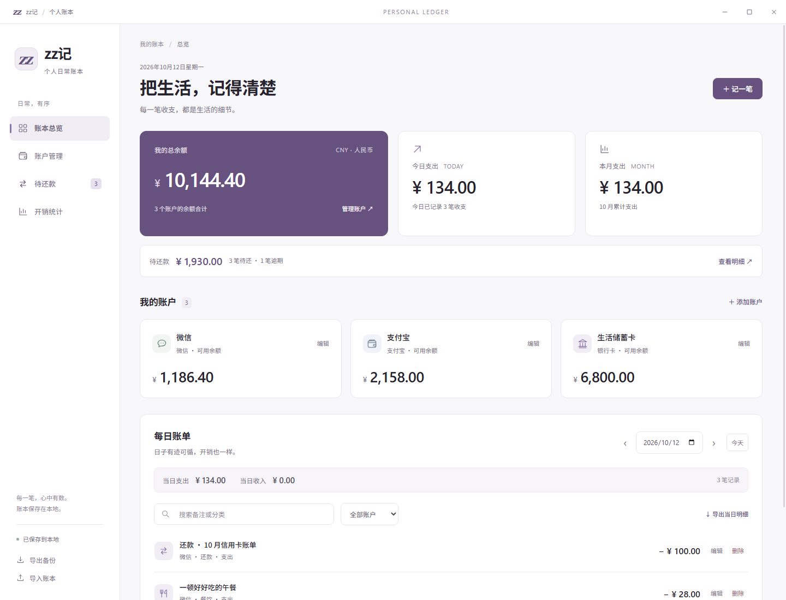
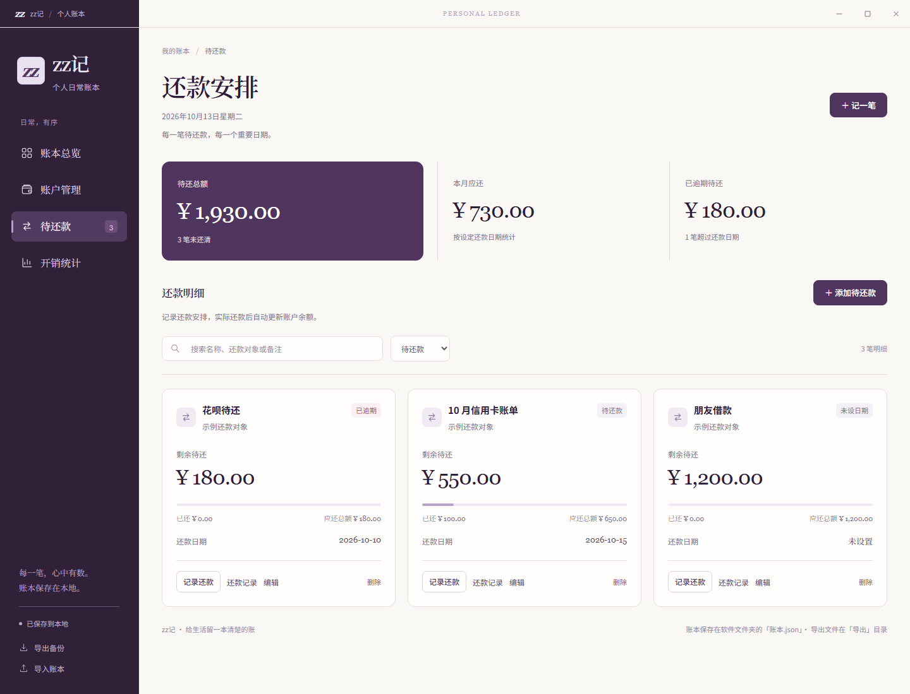

# zz记 · 日常账本

深紫与暖白配色的 Windows 本地记账软件，支持账户管理、每日收支记录和开销统计。



预览使用示例数据。

## iPhone 版本

新增面向 iOS 16+ 的个人使用开发工程，支持离线记账、账户划转、待还款、统计和跨端 JSON 备份。打开 `ios/ZZLedger.xcodeproj`，使用自己的 Apple 账户签名安装。当前尚未完成 iOS 编译和真机验收；安装步骤、已验证范围和剩余验证项目见 [iOS 说明](ios/README.md)。

界面采用 A 方案的编辑式账本设计：深紫侧栏、暖白背景、衬线金额和低调植物线稿。首页左侧展示余额与支出，右侧展示账户列表和待还款摘要；每日账单在下方，窄窗口自动上下排列。详见[视觉设计规范](docs/design-system.md)。

## Windows 软件

双击项目文件夹中的 **zz记.exe**，打开软件。使用打包后的软件不需要安装 Python 或 Node.js。界面使用 Microsoft Edge WebView2 运行；如其他电脑缺少运行时，可从[微软官网](https://developer.microsoft.com/microsoft-edge/webview2/)下载并安装。

数据文件均在 **zz记.exe 所在文件夹**，当前为项目文件夹：

- `账本.json`：完整账本，首次启动创建，每次保存即时更新。
- `账本.上一版.json`：自动保留上一次保存的账本，必要时可通过「导入账本」恢复。
- `导出/`：点击导出备份或导出每日明细后生成的文件。

请把软件放在有写入权限的文件夹。移动软件时，请同时移动 `账本.json` 与备份文件。关闭软件后再手动修改账本；同一文件夹只允许一个软件实例运行。已有账本可直接继续使用，无需迁移。

桌面源码入口为 `desktop.py`，打包脚本为 `build_desktop.py`。重新打包：

```powershell
python -m venv .desktop-venv
.\.desktop-venv\Scripts\python.exe -m pip install -r requirements-desktop.txt
.\.desktop-venv\Scripts\python.exe build_desktop.py
```

## 开始使用

启动 `zz记.exe`。首次使用时包含微信、支付宝、银行卡三个零余额账户。先在「账户管理」设置余额，再点击「记一笔」记录日常开销。

- 自由添加、编辑账户名称、类型和当前余额。
- 支出自动扣减余额，收入自动增加余额，总余额同步更新。
- 编辑账单会先撤销原记录的余额变动，再应用新记录；删除记录会恢复余额。
- 有关联账单的账户不能直接删除，避免历史账单丢失。无关联账单的账户可以删除。
- 按日期查看每日收支，支持账户筛选、备注搜索、每日 CSV 明细导出。
- 「开销统计」显示每月收支、每日支出和分类占比，点击每日柱形可查看当天账单。
- 「导出备份」保存完整 JSON 账本，「导入账本」校验后替换当前数据。
- 「待还款」记录信用卡、花呗、借款等明细，显示待还总额、剩余金额、还款对象、日期和逾期状态；支持搜索、筛选与部分还款。
- 添加待还款不会扣减余额。记录实际还款时选择付款账户，自动生成「还款」支出。编辑或撤销这笔账单时，余额和待还金额同步恢复；已还清明细可在筛选中查看。



数据保存在软件所在文件夹，不连接微信、支付宝或银行，余额需要手动设置。请定期导出备份。编辑账户余额会直接校准余额，不生成收支记录。程序允许负余额并在支出后提示，以便补记历史支出。

## 验证

开发者安装 Node.js 后，可验证金额与记账逻辑：

```sh
node core.test.cjs
node tests/debts.test.cjs
```

安装 Python 后，可验证文件保存、备份和本地接口：

```powershell
python -m unittest discover -s tests
```

## 项目结构

- `desktop.py`：Windows 软件启动入口。
- `zzledger/`：领域校验、文件保存、本机接口、窗口控制与生命周期。
- `build_desktop.py`：生成 `zz记.exe`。
- `ui/`：内嵌界面；`core.js` 处理记账计算，`api.js` 处理异步请求，`app.js` 处理页面交互，`styles/` 分层管理样式。
- `core.test.cjs`、`tests/`：记账、文件保存和窗口控制测试。

窗口使用浅紫色自定义标题栏，支持拖动、双击最大化、最小化和关闭。保存期间显示状态并防止重复提交，写入成功后更新余额。

详细的模块职责与技术流程见[架构说明](docs/architecture.md)。

从源码启动需要先安装桌面依赖，然后运行：

```powershell
.\.desktop-venv\Scripts\python.exe desktop.py
```
